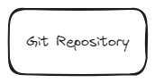

# ZeroFailed

ZeroFailed is an extensible automation framework that aims to help you build flexible and reliable automated processes.

It uses PowerShell Core to enable cross-platform support and using this lower-level toolset allows it to be agnostic about higher-level tools that may consume it (e.g. CI/CD platforms), whilst at the same time being able to integrate with them where desirable. It requires PowerShell 7.1 or later.

The framework allows you to build & share your own custom automation functionality, whilst our library of extensions provide opinionated solutions for specific scenarios that have been used to deliver Real World projects.

ZeroFailed uses a Directed Acyclic Graph (DAG) approach to orchestrating these processes, and leverages the excellent [InvokeBuild](https://github.com/nightroman/Invoke-Build) PowerShell module, rather than reinventing the wheel.  For more details on why you might want to design your automated processes around InvokeBuild, please refer to its [wiki](https://github.com/nightroman/Invoke-Build/wiki/Concepts).

As an example, lets consider a software build process. ZeroFailed enables you to:

- Bootstrap and configure the process by adding just 2 files to your repo:
    - A boilerplate entrypoint script that installs the top-level PowerShell module dependencies:
        - [InvokeBuild](https://www.powershellgallery.com/packages/InvokeBuild)
        - [ZeroFailed](https://www.powershellgallery.com/packages/ZeroFailed)
    - A configuration script, by convention stored in `.zf/config.ps1`, that defines:
        - One or more `ZeroFailed` extension modules that implement the functionality needed for the process (and optionally, the process itself)
        - Configuration to drive those extensions for this specific process
        - `InvokeBuild` task definitions for custom functionality specific to this process

Examples of these files can be found [here](./examples/). We also have a [collection of sample repositories](https://github.com/search?q=org%3Azerofailed+ZeroFailed.Sample&type=repositories) that demonstrate how to use many of our extensions.

Reference documentation for the functions provided by the core `ZeroFailed` module is available in the [Function Reference](./docs/functions/README.md).

## Extensions

Extensions are PowerShell modules that follow the conventions below to offer specific features to ZeroFailed processes that consume them.

These features are delivered using 4 different types of component:

1. Functions - regular PowerShell functions to encapsulate functionality consumed by Tasks
1. Tasks - definitions of InvokeBuild tasks
1. Processes - orchestrate a sequence of Tasks to execute as an automated process
1. Properties - configuration settings that control the behaviour of Tasks and Processes

An extension will organise its components as follows:

- Shared functions are defined in a `functions` directory
- Shared InvokeBuild tasks & properties are defined in a `tasks` directory
- OPTIONAL: Dependencies on other extensions are declared in the module manifest under the `PrivateData.ZeroFailed.ExtensionDependencies` key (see [Declaring dependencies](#declaring-dependencies) below). A legacy `dependencies.psd1` file is also supported as a fallback.
- OPTIONAL: 1 or more InvokeBuild process definitions - currently these can reside anywhere within the module, with the onus being on the consumer to reference the required path.

For example:
```
<module-root>/
├── functions/
│   ├── functionA.ps1
│   └── functionB.ps1
├── tasks/
│   ├── tasksGroupA.properties.ps1    (a .properties.ps1 file contains variables that can be used to alter the behaviour of the associated tasks)
|   ├── tasksGroupA.tasks.ps1         (a .tasks.ps1 file may contain 1 or more task definitions)
│   ├── tasksGroupB.properties.ps1
│   ├── tasksGroupB.tasks.ps1
│   ├── bigTask.tasks.ps1             (a complex task may be defined in a dedicated code file)
│   └── someProcess.build.ps1
├── MyExtension.psd1                  (the module manifest, which declares any extension dependencies)
└── MyExtension.psm1
```

### Declaring dependencies

It is common for an extension to depend on other extensions. The preferred way to declare these is in the module manifest (`.psd1`) under the `PrivateData.ZeroFailed.ExtensionDependencies` key. ZeroFailed resolves and installs these dependencies automatically.

The dependencies can be specified using a short-hand syntax (just the extension name, resolved from the default PowerShell repository), a full syntax (a hashtable that can also pin a `Version`, set a `MinimumVersion`, or reference a `GitRepository`/`GitRef`), or a mix of the two:

```powershell
PrivateData = @{
    ZeroFailed = @{
        ExtensionDependencies = @(
            'ZeroFailed.Build.Common'                       # short-hand: latest from the default repository
            @{
                Name = 'ZeroFailed.Build.DotNet'            # full: pinned version
                Version = '1.5.0'
            }
            @{
                Name = 'MyExtension'                        # full: from a git repository
                GitRepository = 'https://github.com/myorg/myextension'
                GitRef = 'main'
            }
        )
    }
}
```

> A legacy `dependencies.psd1` file at the module root is still supported as a fallback, but the manifest-based approach above is preferred.

A dependency on `main`, or on the latest version, can change at any time. To get fixes without breaking changes, depend on released versions with a `MinimumVersion`.

### Minimum versions

`MinimumVersion` installs the newest release of an extension that is at least that version, but below the next major version. A new major version can contain breaking changes, so ZeroFailed does not install it automatically. For example, `MinimumVersion = '1.4.0'` accepts `1.4.0`, `1.4.3` and `1.9.0`, but not `2.0.0`. Use `MinimumVersion` in place of `Version` or `GitRef`, not with them.

You can use `MinimumVersion` in your configuration and in the dependencies that an extension declares:

```powershell
@{
    Name = 'ZeroFailed.Build.Common'                        # from the default PowerShell repository
    MinimumVersion = '1.4.0'
}
@{
    Name = 'MyExtension'                                    # from the release tags of a git repository
    GitRepository = 'https://github.com/myorg/myextension'
    MinimumVersion = '1.4.0'
}
```

These rules decide which versions are in the range:

- Before version 1.0.0, the first part that is not zero sets the limit. For example, `MinimumVersion = '0.3.1'` accepts versions below `0.4.0`.
- ZeroFailed installs a pre-release version only when you also set `PreRelease = $true`.
- In a git repository, a release is a tag named after a full semantic version (for example, `1.4.2` or `v1.4.2`). The `v` prefix is optional. ZeroFailed ignores other tags, such as `v1`.
- If a release in the range is already installed, ZeroFailed uses it. To update to the newest release, delete the extension's folder in `.zf/extensions`, then run again.

#### When several extensions require the same extension

ZeroFailed installs one version of each extension, so that version must be in every range that the extensions require. A pre-release version is in a range only when that extension sets `PreRelease = $true`.

- If your configuration includes the extension, ZeroFailed uses the version from your configuration, wherever you list it. It shows a warning when that version is outside a range that another extension requires.
- Otherwise, ZeroFailed uses the newest version that is in every range. For example, an installed `1.3.0` meets "1.2.0 or later", but another extension requires "1.5.0 or later". ZeroFailed installs the newest `1.x` release for the second extension, and uses it for both.
- If no version is in every range, the run fails. For example, two extensions can require different major versions. To choose a version yourself, add the extension to your configuration.

These rules apply only when at least one extension uses `MinimumVersion`. Otherwise, ZeroFailed uses the first one that it registers. It registers each extension in your configuration, in order, followed by that extension's dependencies. To choose a version in that case, list the extension in your configuration before the extensions that require it.

When ZeroFailed uses a newer copy in place of an older installed copy, it still registers the dependencies that only the older copy declares. To remove them, delete the older copy's folder in `.zf/extensions`, then run again.

### Using Extensions

A ZeroFailed-based process can use extensions by referencing them via the `zerofailedExtensions` property in its `.zf/config.ps1` file.

Extensions can be shared as modules published to a PowerShell repository (e.g. PowerShell Gallery) or via public git repositories. ZeroFailed will take care of downloading the required extensions and making their functionality available to your process.

#### Simple Syntax

This uses the simplest syntax to reference the latest stable versions of 2 extensions available via PowerShell Gallery.

```
$zerofailedExtensions = @(
    "ZeroFailed.Build.DotNet"
    "ZeroFailed.Build.Containers"
)
```

#### Advanced Syntax - PowerShell Module Repository

This uses the richer syntax to reference specific versions of 2 public extensions and an internal extension available via a private repository.

```
$zerofailedExtensions = @(
    @{
        Name = "ZeroFailed.Build.DotNet"
        Version = "1.5.0"
    }
    @{
        Name = "ZeroFailed.Build.Containers"
        Version = "1.3.0"
    }
    @{
        Name = "MyCustomExtension"
        PSRepository = "MyPrivatePSRepository"
    }
)
```

To get newer releases without breaking changes, use `MinimumVersion` in place of `Version`. See [Minimum versions](#minimum-versions).

#### Advanced Syntax - Git Repository

It is also possible to reference extensions that are available via public git repositories.

This shows the different syntax options:
* Omitting the `GitRef` property will default to the `main` branch
* The full range of git references can be used to select specific a branch, tag or commit
* Using `MinimumVersion` in place of `GitRef` installs the newest release tag in a range (see [Minimum versions](#minimum-versions))

```
$zerofailedExtensions = @(
    @{
        Name = "ZeroFailed.Build.DotNet"
        GitRepository = "https://github.com/zerofailed/ZeroFailed.Build.DotNet"
    }
    @{
        Name = "ZeroFailed.Build.Containers"
        GitRepository = "https://github.com/zerofailed/ZeroFailed.Build.Containers"
        GitRef = "feature/myfeature"
    }
    @{
        Name = "MyCustomExtension1"
        GitRepository = "https://github.com/myorg/MyZeroFailedExtension"
        GitRef = "refs/tags/1.0.0"
    }
    @{
        Name = "MyCustomExtension2"
        GitRepository = "https://github.com/myorg/MyZeroFailedExtension2"
        GitRef = "87c819e2f8cfc948ca7195fe26ab0e6ecba5f4bc"
    }
)
```

#### Syntax for local development testing

This shows how to reference an extension available via a local file path, which can be useful when testing or debugging your own extensions.

```
$zerofailedExtensions = @(
    @{
        Name = "MyCustomExtension"
        Path = "~/MyCustomExtension/module/MyCustomExtension.psd1"
    }
)
```

### Locking extension versions

A reference such as `GitRef = "main"`, or a PowerShell module without a `Version`, installs whatever version is newest at the time. A `MinimumVersion` installs the newest release in its range. The same is true of the dependencies that extensions declare, which you do not control. To make every run use the same versions, ZeroFailed records the exact version of every installed extension, including dependencies, in the lock file `.zf/extensions.lock.json`.

Commit the lock file to your repository.

#### Lock modes

| Mode | What happens |
| --- | --- |
| `Write` (default) | Extensions are resolved as normal, then the lock file is created or updated to record what is installed. |
| `Frozen` | Each extension is installed at the commit or version in the lock file. The run fails if there is no lock file, or if any extension differs from it. ZeroFailed checks each extension's content against the lock file before it runs any of the extension's code. The lock file is not changed. |
| `Off` | The lock file is not used. |

Set the mode with the `ZF_EXTENSIONS_LOCK_MODE` environment variable, or with the `$zerofailedExtensionsLockMode` variable before `ZeroFailed.tasks` is called in `.zf/config.ps1`. The environment variable takes precedence, so a CI/CD pipeline can use `Frozen` without changing the configuration. For example, in a GitHub Actions workflow:

```yaml
env:
  ZF_EXTENSIONS_LOCK_MODE: Frozen
```

#### What the lock file records

For each extension, the lock file records:

| Property | Description |
| --- | --- |
| `source` | Where the extension comes from: a git repository and folder, a PowerShell repository, or a local path. For a PowerShell repository, or a git `MinimumVersion`, it also records whether pre-release versions are allowed. |
| `requested` | The `GitRef` or `Version` in the configuration, or the range of a `MinimumVersion` (for example, `[1.4.0,2.0.0)`). |
| `resolved` | The commit or exact module version that was installed. |
| `resolvedRef` | For a git `MinimumVersion`, the release tag that was installed (for example, `refs/tags/1.4.2`). |
| `contentHash` | A SHA256 hash of the installed files. Line endings are normalised, so the hash is the same on every platform. |
| `direct` | Whether the extension is in the configuration, rather than only being a dependency of another extension. |
| `requiredBy` | The extensions that declare it as a dependency. |

Extensions referenced by a local `Path` are recorded, but not locked, because they are working copies.

#### Updating locked versions

In `Write` mode, an extension that is already installed is used as it is, so the lock file records the versions that you have installed. To update to the newest versions (e.g. the latest commit of `main`), delete the extension's folder in `.zf/extensions`, run again, and commit the updated lock file.

When you change the extensions in the configuration, run once in `Write` mode to update the lock file. Otherwise a `Frozen` run fails because the configuration differs from the lock file.

A `MinimumVersion` uses the locked version when it comes from the same source and is in the range, even when the lock file records a different `requested` range. Several extensions can require the same extension with different minimum versions, and the lock file records only one of them. So a `Frozen` run treats a `MinimumVersion` as different from the lock file only when the locked version is outside its range.

ZeroFailed records the commit of an extension installed from a git repository in a `.zf-source.json` file in its folder, along with the repository and folder it came from. If you change an extension's `GitRepository` or `GitRepositoryFolderPath`, for example to use a fork, ZeroFailed re-installs it from the new source. Extensions installed by earlier versions of ZeroFailed do not have this file, so their commit is unknown. ZeroFailed warns about these, and you can delete their folders to re-install them and record their commits.


## ZeroFailed Process Overview

The diagram below provides an overview of how a ZeroFailed-based process interacts with the extensibility framework when it is executed.

